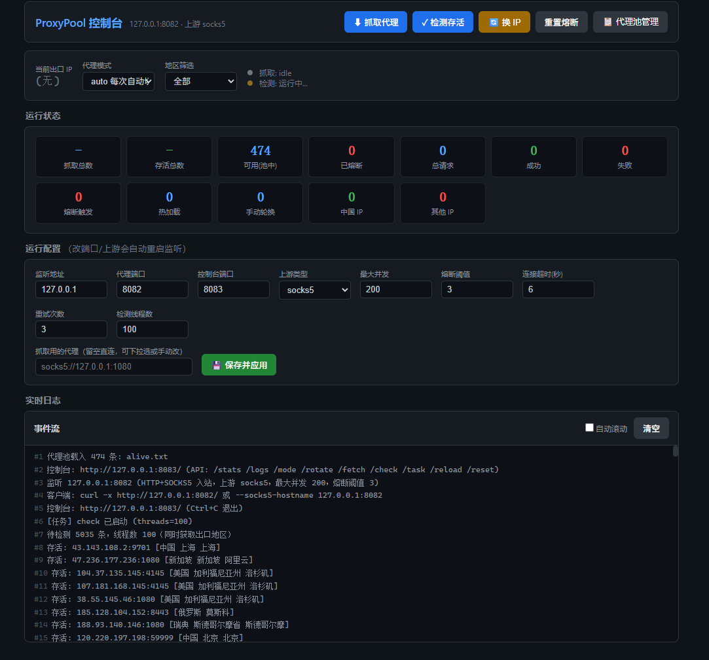
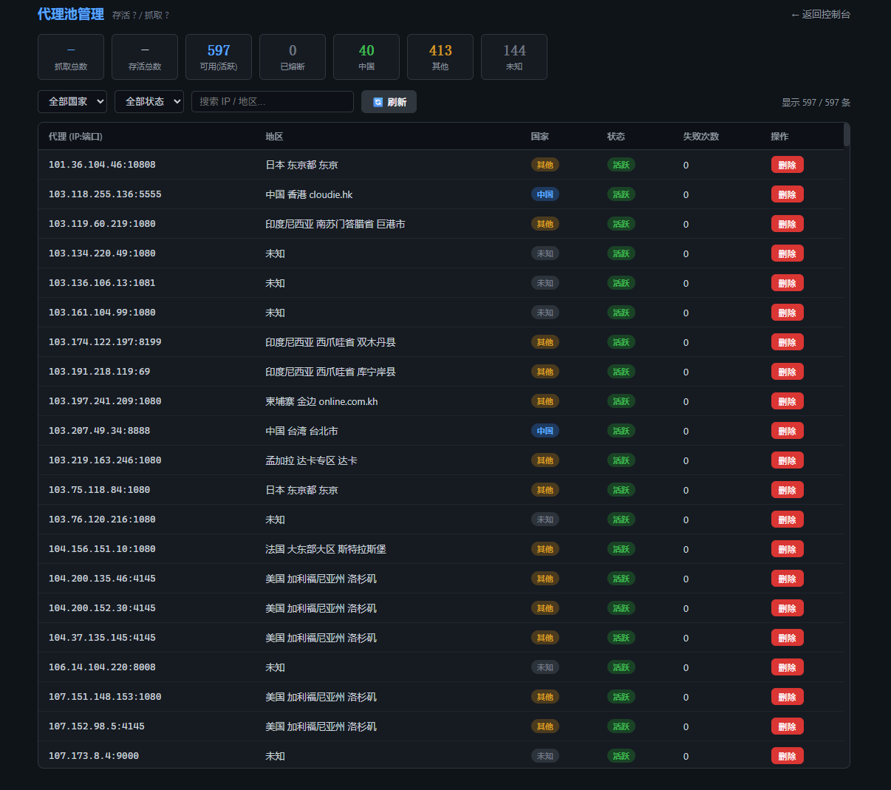
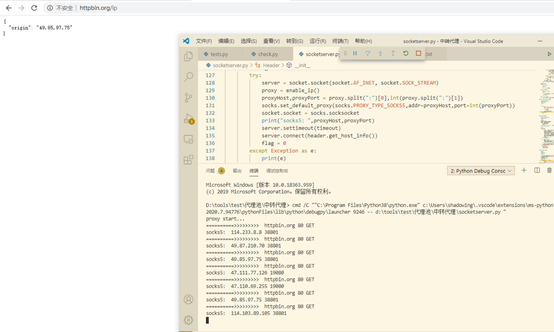
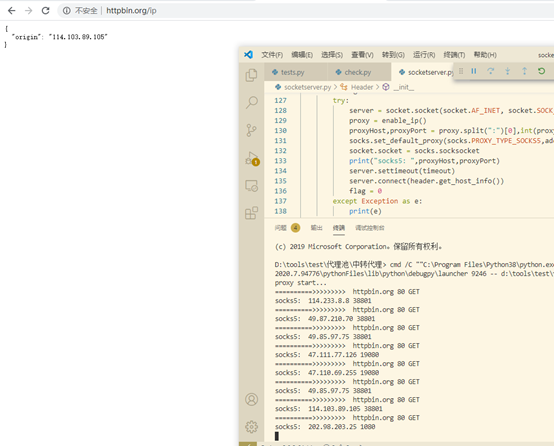

# ProxyPool

自动轮换出口 IP 的代理池，带 Web 控制台。抓取免费代理 → 检测存活（含地区识别）→ 启动 HTTP/SOCKS5 代理服务，每次请求换一个出口 IP，配合 BurpSuite、curl、proxychains 等实现 IP 轮换。

[English](README_EN.md)

## 使用

```bash
pip install -r requirements.txt
python3 main.py serve
```

启动后浏览器打开控制台 **http://127.0.0.1:8083/** ，所有操作都在网页里完成：

- **抓取代理 / 检测存活**：点按钮即可，检测时自动识别出口 IP 地区，进度实时显示在日志区
- **三种代理模式**：auto（每次换IP）/ sticky（保持同IP）/ manual（手动锁定）
- **地区筛选**：只用中国 / 其他地区的代理
- **运行配置**：端口、上游类型、并发数、熔断阈值等，网页里改完点保存即生效（改端口会自动重启监听）
- **实时状态**：抓取总数、存活总数、可用代理、成功/失败、熔断数、日志流
- **代理池管理**：单独页面查看/搜索/筛选/删除池中每个代理





配置自动保存在 `config.json`，下次启动沿用。`Ctrl+C` 干净退出。

## 客户端连接

serve 的代理端口（默认 8082）同时支持 HTTP 和 SOCKS5 两种协议，按需选用：

```bash
# 作为 HTTP 代理（BurpSuite、浏览器、curl）
curl -x http://127.0.0.1:8082 http://httpbin.org/ip

# 作为 SOCKS5 代理（curl、proxychains、Telegram 等）
curl --socks5-hostname 127.0.0.1:8082 http://httpbin.org/ip
```

多次执行，`origin` 字段会不断变化，说明出口 IP 在轮换：





## 子命令（可选）

不通过控制台时，也可命令行分步操作：

| 命令 | 作用 |
|------|------|
| `main.py serve` | 启动代理服务 + 控制台（默认行为，所有配置可在网页改） |
| `main.py fetch` | 抓取代理到 socks.txt |
| `main.py check` | 检测存活写入 alive.txt（同时获取地区） |
| `main.py run` | 一键全流程 fetch → check → serve |
