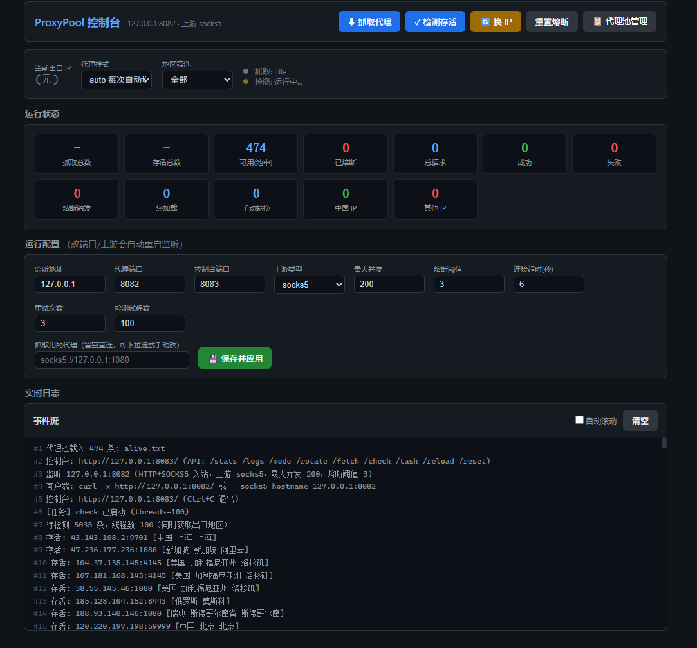
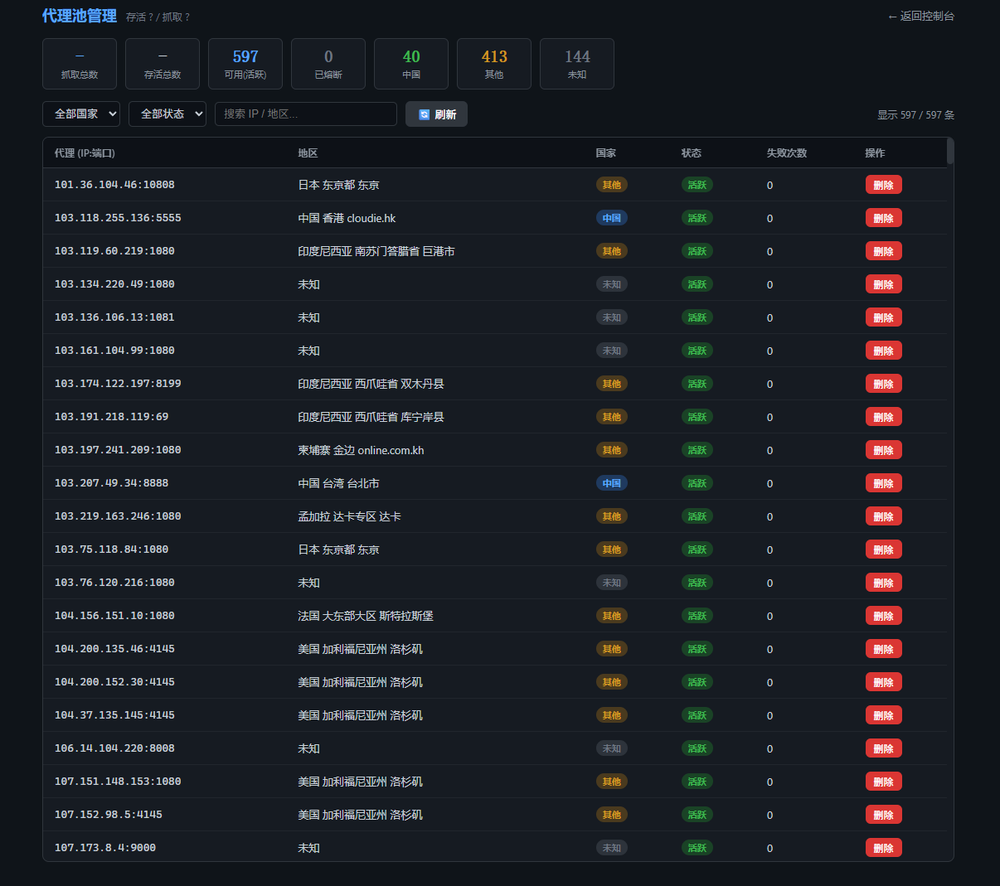
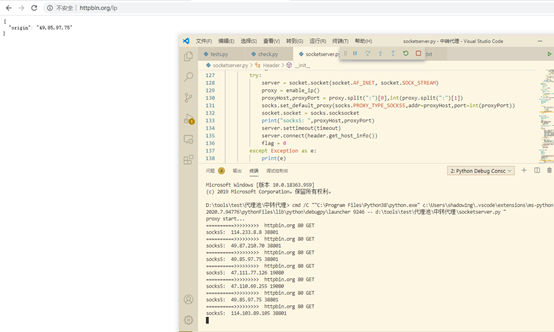
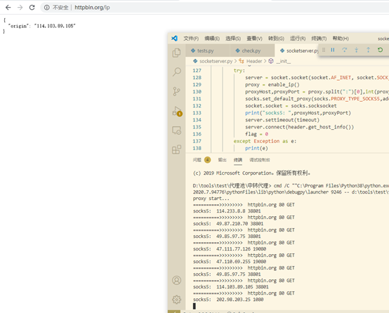

# ProxyPool

A proxy pool with automatic IP rotation and a web console. Fetch free proxies → check liveness (with region detection) → run an HTTP/SOCKS5 proxy service that rotates the exit IP per request. Works with BurpSuite, curl, proxychains, etc.

[中文文档](README.md)

## Usage

```bash
pip install -r requirements.txt
python3 main.py serve
```

Open the console in your browser at **http://127.0.0.1:8083/** — everything is done from the web UI:

- **Fetch / Check**: one click each. Checking automatically detects each proxy's exit-IP region; progress streams into the log panel.
- **Three modes**: `auto` (rotate per request) / `sticky` (keep same IP) / `manual` (locked, manual switch).
- **Region filter**: use only China / other regions.
- **Runtime config**: port, upstream type, concurrency, circuit-breaker threshold, etc. — edit on the page and save to apply (changing the port auto-restarts the listener).
- **Live stats**: fetched total, alive total, available proxies, success/fail, circuit breaks, log stream.
- **Pool management**: a dedicated page to view / search / filter / delete every proxy in the pool.





Config is persisted to `config.json` and reused on next start. Press `Ctrl+C` for a clean shutdown.

## Client connection

The proxy port (default 8082) speaks both HTTP and SOCKS5 — pick either:

```bash
# As an HTTP proxy (BurpSuite, browsers, curl)
curl -x http://127.0.0.1:8082 http://httpbin.org/ip

# As a SOCKS5 proxy (curl, proxychains, Telegram, etc.)
curl --socks5-hostname 127.0.0.1:8082 http://httpbin.org/ip
```

Run it a few times — the `origin` field keeps changing, showing the exit IP rotating:





## Subcommands (optional)

If you prefer the CLI instead of the console:

| Command | Purpose |
|---------|---------|
| `main.py serve` | Start proxy service + console (default; all settings editable from the web UI) |
| `main.py fetch` | Fetch proxies into socks.txt |
| `main.py check` | Check liveness into alive.txt (also detects region) |
| `main.py run` | Full pipeline: fetch → check → serve |
